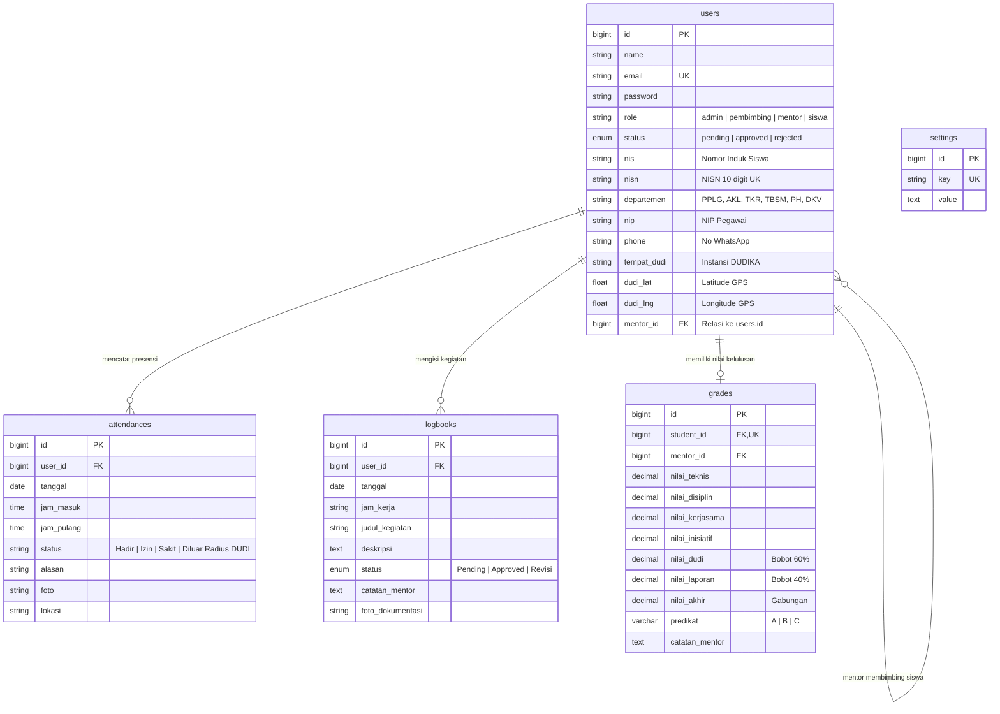

# Portal Jurnal PKL Digital — SMK Negeri 1 Depok

<p align="center">
  
</p>

<p align="center">
  
  
  
  
  
  
</p>

---

## 📌 1. Tentang Aplikasi

**Jurnal PKL Digital SMK Negeri 1 Depok** adalah sistem informasi manajemen terpadu yang dirancang untuk mengelola seluruh siklus pelaksanaan **Praktik Kerja Lapangan (PKL)** siswa di Dunia Usaha, Dunia Industri, dan Dunia Kerja (DUDIKA).

Sistem ini menghubungkan 4 peran utama secara real-time:
1. **Admin Pokja Hubin:** Verifikasi persetujuan akun, plotting industri, timeline, kuota, dan ekspor sertifikat.
2. **Guru Pembimbing Sekolah:** Monitoring kehadiran, evaluasi naskah laporan PKL (bobot 40%), dan ekspor rekapitulasi nilai.
3. **Mentor Industri DUDIKA:** Monitoring bimbingan industri, validasi jurnal harian (*Approved* / *Revisi*), dan penilaian 4 pilar kompetensi kerja (bobot 60%).
4. **Siswa Magang:** Presensi berbasis geofencing GPS (formula Haversine), pengisian logbook harian, dan pelacakan kelulusan.

---

## 🗂️ 2. Peta Arsitektur Direktori & File

Berikut adalah struktur folder utama yang perlu dipahami oleh *backend developer junior*:

```text
web-jurnal-pkl-digital/
├── app/
│   ├── Http/
│   │   ├── Controllers/
│   │   │   ├── AdminController.php         # Manajemen akun, plotting DUDI, ekspor laporan & sertifikat
│   │   │   ├── AttendanceController.php    # Presensi GPS & algoritma geofencing Haversine
│   │   │   ├── AuthController.php          # Login, registrasi mandiri, gerbang approval & honeypot anti-bot
│   │   │   ├── LogbookController.php       # Pencatatan jurnal kegiatan harian siswa
│   │   │   ├── MentorController.php        # Validasi logbook bimbingan & penilaian DUDI 4 pilar
│   │   │   ├── PembimbingController.php    # Penilaian naskah laporan sekolah (60:40) & sanitasi CSV
│   │   │   └── SiswaController.php         # Dashboard ringkasan siswa, profil telepon & ganti password
│   │   └── Middleware/
│   │       ├── RoleMiddleware.php          # Pemeriksaan hak akses peran pengguna (RBAC)
│   │       ├── SanitizeInputMiddleware.php # Sanitasi input form (Anti-XSS & HTML tag stripping)
│   │       └── SecurityHeadersMiddleware.php # Injeksi HTTP headers (Anti-Clickjacking, CSP, HSTS)
│   └── Models/
│       ├── Attendance.php                  # Model data absensi harian GPS (casts: date)
│       ├── Grade.php                       # Model nilai akhir & dual-assessment (casts: float)
│       ├── Logbook.php                     # Model jurnal kegiatan harian (casts: date)
│       ├── Setting.php                     # Model key-value konfigurasi dinamis sistem
│       └── User.php                        # Model pengguna 4 role (casts: float dudi_lat/lng)
├── database/
│   ├── factories/                          # Factory data dummy untuk testing (UserFactory)
│   ├── migrations/                         # Migrasi skema database (users, attendances, logbooks, grades)
│   └── seeders/
│       ├── DatabaseSeeder.php              # Seeder induk pemanggil
│       └── UserSeeder.php                  # Akun bawaan siap pakai (Admin, Pembimbing, Mentor, Siswa)
├── resources/
│   └── views/
│       ├── auth/
│       │   ├── login.blade.php             # Form login responsif + honeypot trap
│       │   └── register.blade.php          # Form registrasi (pilihan 3 role, NISN, 6 jurusan)
│       ├── dashboards/
│       │   ├── admin.blade.php             # Portal Pokja Hubin (tabbed navigation, modal, tabel responsive)
│       │   ├── create-logbook.blade.php    # Form entri jurnal kegiatan harian
│       │   ├── mentor-dudi.blade.php       # Portal Mentor DUDIKA (review logbook & modal input nilai)
│       │   ├── pembimbing.blade.php        # Portal Guru Pembimbing (evaluasi laporan & monitoring DUDI)
│       │   └── siswa.blade.php             # Portal Siswa (Peta Leaflet GPS, absensi masuk/pulang, logbook)
│       └── welcome.blade.php               # Landing page resmi SMKN 1 Depok responsif
├── routes/
│   └── web.php                             # Definisi rute, regex constraint, throttle anti-DDoS, dan RBAC
├── storage/
│   └── app/public/.htaccess                # Proteksi anti-malware: cegah eksekusi skrip di folder upload
└── tests/
    └── Feature/
        ├── AuthAndRegistrationTest.php     # 10 Pengujian autentikasi, NISN & validasi jurusan
        ├── CyberSecurityHardeningTest.php  # 9 Pengujian keamanan siber (SQLi, XSS, Honeypot, IDOR, CSV)
        └── SecurityAndAuthorizationTest.php # 9 Pengujian geofencing GPS, IDOR mentor, dan RBAC
```

---

## 👥 3. Matriks Hak Akses Peran (RBAC Matrix)

| Fitur / Aksi | Admin Pokja Hubin (`admin`) | Guru Pembimbing (`pembimbing`) | Mentor DUDIKA (`mentor`) | Siswa Magang (`siswa`) |
| :--- | :---: | :---: | :---: | :---: |
| **Persetujuan Akun Baru (Pending -> Approved)** | ✅ Ya | ❌ Tidak | ❌ Tidak | ❌ Tidak |
| **Plotting Siswa ke DUDI & Pasang Mentor** | ✅ Ya | ❌ Tidak | ❌ Tidak | ❌ Tidak |
| **Presensi GPS (Check-In & Check-Out)** | ❌ Tidak | ❌ Tidak | ❌ Tidak | ✅ Ya |
| **Pencatatan Jurnal Harian (Logbook)** | ❌ Tidak | ❌ Tidak | ❌ Tidak | ✅ Ya |
| **Validasi Logbook (Setujui / Revisi)** | ❌ Tidak | ❌ Tidak | ✅ Ya (Siswa Binaan) | ❌ Tidak |
| **Penilaian 4 Pilar Kompetensi Industri (60%)** | ❌ Tidak | ❌ Tidak | ✅ Ya (Siswa Binaan) | ❌ Tidak |
| **Penilaian Naskah Laporan PKL (40%)** | ❌ Tidak | ✅ Ya | ❌ Tidak | ❌ Tidak |
| **Kalkulasi Nilai Akhir & Predikat A/B/C** | ❌ Otomatis | ✅ Otomatis | ❌ Otomatis | ❌ Otomatis |
| **Ekspor Rekapitulasi Nilai (CSV)** | ❌ Tidak | ✅ Ya | ❌ Tidak | ❌ Tidak |
| **Ekspor Rekap Laporan & Absensi (Excel)** | ✅ Ya | ❌ Tidak | ❌ Tidak | ❌ Tidak |
| **Unduh Sertifikat Penghargaan PKL** | ✅ Seluruh Siswa | ✅ Seluruh Siswa | ✅ Siswa Binaan | ✅ Milik Sendiri |

---

## 🧠 4. Bedah Mendalam 7 Logika Bisnis Inti Backend

Bagi para *backend developer*, berikut adalah penjelasan lengkap alur logika di balik kode aplikasi:

### 1️⃣ Logika 1: Registrasi Mandiri, Honeypot Anti-Bot & Gerbang Approval
*File:* `app/Http/Controllers/AuthController.php`
- **Jebakan Honeypot Anti-Bot:** Form login dan registrasi menyertakan input tersembunyi `<input type="text" name="_honey_guard">` yang tidak terlihat oleh mata manusia. Bot web scanner otomatis mengisi seluruh input form. Jika field ini terisi saat request masuk, sistem langsung menolaknya secara senyap tanpa memproses ke database.
- **Validasi Siswa Spesifik:**
  - Siswa wajib memiliki `nisn` tepat 10 digit numerik dan unik secara nasional.
  - Bidang keahlian `departemen` dibatasi hanya pada 6 jurusan resmi SMKN 1 Depok: `PPLG`, `AKL`, `TKR`, `TBSM`, `PH`, `DKV`.
- **Kompleksitas Sandi:** Menggunakan `Password::min(8)->letters()->mixedCase()->numbers()->symbols()`.
- **Gerbang Approval:** Setiap akun baru otomatis dibuat dengan status `pending`. Pengguna tidak dapat masuk ke sistem sampai Administrator Pokja Hubin mengklik tombol *Setujui* (`approved`).

### 2️⃣ Logika 2: Presensi GPS & Formula Geofencing Haversine
*File:* `app/Http/Controllers/AttendanceController.php`
- **Validasi Koordinat:** Saat siswa memilih status `Hadir`, browser membaca koordinat geolokasi gawai siswa (`lat` dan `lng`).
- **Kalkulasi Jarak Haversine:**
  Sistem menghitung jarak lengkung bola bumi antara koordinat siswa $(lat_1, lon_1)$ dengan koordinat kantor DUDIKA $(lat_2, lon_2)$:
  $$\Delta lat = lat_1 - lat_2, \quad \Delta lon = lon_1 - lon_2$$
  $$a = \sin^2\left(\frac{\Delta lat}{2}\right) + \cos(lat_2) \cdot \cos(lat_1) \cdot \sin^2\left(\frac{\Delta lon}{2}\right)$$
  $$c = 2 \cdot \text{atan2}\left(\sqrt{a}, \sqrt{1 - a}\right)$$
  $$d = R \cdot c \quad (\text{dengan } R = 6.371.000 \text{ meter})$$
- **Toleransi Radius 150 Meter:**
  - Jika $d \le 150$ meter: Status tercatat `Hadir` ("✓ Dalam radius valid").
  - Jika $d > 150$ meter: Status otomatis diubah menjadi `Diluar Radius DUDI` ("⚠️ Jarak terlalu jauh: X meter") dan siswa otomatis ditandai di dashboard admin pada daftar *"Siswa Perlu Perhatian"*.
- **Pencatatan Masuk vs Pulang:** Panggilan presensi pertama hari itu mencatat `jam_masuk`. Panggilan presensi kedua pada hari yang sama mencatat `jam_pulang`.

### 3️⃣ Logika 3: Jurnal Harian (Logbook) & Proteksi Anti-IDOR
*Files:* `app/Http/Controllers/LogbookController.php` & `MentorController.php`
- **Pencatatan:** Siswa mencatat tanggal, jam kerja, judul pekerjaan, dan deskripsi tugas. Status awal adalah `Pending`.
- **Sanitasi Masukan:** Sebelum disimpan ke basis data, middleware `SanitizeInputMiddleware` membersihkan tag `<script>` dan tag HTML berbahaya.
- **Proteksi IDOR (Insecure Direct Object Reference):** Mentor industri hanya memiliki otoritas memvalidasi (`Approved` / `Revisi`) logbook milik siswa yang secara resmi ditugaskan kepadanya:
  ```php
  if ($logbook->user?->mentor_id !== Auth::id()) {
      abort(403, 'Akses Ditolak: Anda hanya memiliki izin memvalidasi siswa bimbingan Anda.');
  }
  ```

### 4️⃣ Logika 4: Mesin Penilaian Ganda (Dual-Assessment Engine)
*Files:* `app/Http/Controllers/MentorController.php` & `PembimbingController.php`
- **Nilai DUDIKA (Bobot 60%):**
  Mentor menginput 4 pilar kompetensi industri (skala 0 - 100):
  $$\text{Nilai DUDI} = \frac{\text{Teknis} + \text{Disiplin} + \text{Kerjasama} + \text{Inisiatif}}{4}$$
- **Nilai Laporan Sekolah (Bobot 40%):**
  Guru Pembimbing mengevaluasi naskah laporan PKL (skala 0 - 100).
- **Kalkulasi Nilai Akhir Gabungan:**
  $$\text{Nilai Akhir} = (\text{Nilai DUDI} \times 0.60) + (\text{Nilai Laporan} \times 0.40)$$
- **Konversi Predikat Kelulusan:**
  - $\ge 85.00 \rightarrow \mathbf{A}$ (Sangat Baik / Lulus Memuaskan)
  - $75.00 - 84.99 \rightarrow \mathbf{B}$ (Baik / Lulus)
  - $60.00 - 74.99 \rightarrow \mathbf{C}$ (Cukup / Perlu Evaluasi)
  - $< 60.00 \rightarrow \mathbf{D}$ (Kurang)

### 5️⃣ Logika 5: Plotting Siswa & Manajemen Kemitraan DUDIKA
*File:* `app/Http/Controllers/AdminController.php`
- Admin Pokja Hubin memilih kelompok siswa, mengikatnya ke nama perusahaan mitra (`tempat_dudi`), menetapkan koordinat GPS presensi (`dudi_lat`, `dudi_lng`), dan menugaskan mentor pembimbing (`mentor_id`).
- Begitu tersimpan, siswa langsung dapat melakukan presensi geofencing dan logbook otomatis mengalir ke mentor yang ditentukan.

### 6️⃣ Logika 6: Ekspor Data & Proteksi CSV Formula Injection (DDE)
*Files:* `app/Http/Controllers/PembimbingController.php` & `AdminController.php`
- **Pencegahan Serangan DDE:** Saat mengekspor rekapitulasi ke format CSV/Excel, penyerang bisa menyusupkan formula berbahaya seperti `=cmd|' /C calc'!A0` pada nama siswa. Fungsi `sanitizeCsvField()` otomatis menyisipkan kutip tunggal (`'`) di depan string yang diawali `=`, `+`, `-`, `@`, `\t`, atau `\r` agar spreadsheet memperlakukannya murni sebagai teks dan tidak mengeksekusinya.
- **Otorisasi Cetak Sertifikat:** Siswa hanya diizinkan mengunduh sertifikat miliknya sendiri (`student_id === Auth::id()`). Percobaan mengganti query string ID diblokir dengan status `403 Forbidden`.

### 7️⃣ Logika 7: Lapisan Pertahanan Siber (Defense-in-Depth)
*Files:* `app/Http/Middleware/` & `routes/web.php`
- **`SecurityHeadersMiddleware`:** Menginjeksikan HTTP response headers:
  - `X-Frame-Options: SAMEORIGIN` (Anti-Clickjacking).
  - `Content-Security-Policy (CSP)` (Anti-XSS & pembatasan eksekusi resource).
  - `Strict-Transport-Security (HSTS)` (Anti-MITM / Pemaksaan HTTPS).
  - `X-Content-Type-Options: nosniff` (Anti-MIME Sniffing).
  - `Referrer-Policy: strict-origin-when-cross-origin`.
- **`Route::pattern('id', '[0-9]+')`:** Memastikan parameter ID di seluruh URL hanya menerima karakter numerik, memblokir upaya injeksi SQL di tingkat router.
- **Tiered Rate Limiter:** Pembatasan request berbasis IP untuk mencegah DDoS dan brute force:
  - Login: 5 req/menit.
  - Register: 3 req/menit.
  - Ekspor Laporan: 6 req/menit.
  - Logbook & Absensi: 10 - 15 req/menit.

---

## 🗄️ 5. Diagram Skema Database & Relasi ERD



---

## 🚀 6. Panduan Instalasi & Menjalankan Proyek Lokal

### Persyaratan Sistem:
- **PHP:** Versi 8.4 atau lebih baru (dengan ekstensi `pdo_mysql`, `mbstring`, `openssl`, `curl`).
- **Composer:** Versi 2.x.
- **Database:** MySQL 8.0 (Tersedia otomatis di Laragon / XAMPP).
- **Web Server:** Laragon Apache / Nginx atau `php artisan serve`.

### Langkah-Langkah Setup:

1. **Clone / Buka Direktori Proyek:**
   ```bash
   cd c:\laragon\www\web-jurnal-pkl-digital
   ```

2. **Instal Dependensi PHP:**
   ```bash
   composer install
   ```

3. **Konfigurasi Lingkungan (`.env`):**
   Salin file contoh konfigurasi jika belum ada:
   ```bash
   cp .env.example .env
   php artisan key:generate
   ```
   Pastikan parameter database pada `.env` telah sesuai:
   ```env
   DB_CONNECTION=mysql
   DB_HOST=127.0.0.1
   DB_PORT=3306
   DB_DATABASE=db_jurnal_pkl_digital
   DB_USERNAME=root
   DB_PASSWORD=
   ```

4. **Jalankan Migrasi & Seeder Database:**
   ```bash
   php artisan migrate --seed
   ```

5. **Tautkan Direktori Penyimpanan Publik:**
   ```bash
   php artisan storage:link
   ```

6. **Jalankan Server Lokal:**
   ```bash
   php artisan serve --host=127.0.0.1 --port=8000
   ```
   Buka peramban di: **`http://127.0.0.1:8000`**

---

## 🔑 7. Akun Default Seeder untuk Pengujian

Semua akun di bawah ini telah terdaftar dan berstatus **Approved** di database:

| Peran (Role) | Nama Pengguna | Alamat Email | Kata Sandi | Deskripsi Hak Akses |
| :--- | :--- | :--- | :--- | :--- |
| **Admin Pokja Hubin** | M. Dzikry Fikry | `m.dzikryfikry@gmail.com` | `Dzikry12345#` | **Admin Utama:** Approval akun, plotting, timeline, sertifikat |
| **Admin Pokja Hubin** | Administrator Pokja | `admin@jurnal.com` | `Admin12345#` | **Admin Cadangan:** Akun sistem default |
| **Guru Pembimbing** | Drs. H. Ahmad Sudrajat, M.Pd. | `pembimbing@jurnal.com` | `Guru12345#` | Evaluasi naskah laporan PKL (40%) & ekspor CSV |
| **Mentor DUDIKA** | Ir. Hendra Kurniawan | `mentor@jurnal.com` | `Mentor12345#` | Review logbook & penilaian 4 pilar kompetensi (60%) |
| **Siswa Magang** | Fajar Pratama | `siswa@jurnal.com` | `Siswa12345#` | Siswa PPLG ter-plotting ke PT. Ciptadra Softindo (Depok) |

---

## 🧪 8. Panduan Pengujian Otomatis & Standar Kode

### Menjalankan Seluruh Feature Tests:
Proyek ini dilengkapi dengan 28 skenario pengujian otomatis komprehensif yang menguji otentikasi, perizinan, geofencing GPS, dan pertahanan siber:
```bash
php artisan test --compact
```
*Hasil Verifikasi: **28 Passed (100%), 75 Assertions**.*

### Menjalankan Formatter Kode (Laravel Pint):
Sebelum melakukan commit perubahan kode baru, jalankan linter agar gaya kode sesuai standar PSR-12 / Laravel Boost:
```bash
vendor/bin/pint --dirty --format agent
```

---

## 💡 9. Panduan Kontribusi untuk Developer Junior

1. **Selalu Gunakan Parameter Binding:** Jangan pernah menggunakan string concatenation atau `DB::raw()` dengan input pengguna langsung untuk mencegah SQL Injection.
2. **Komentar Inline Bertahap:** Setiap method baru wajib menyertakan komentar bernomor urut (`// --- LANGKAH 1: ...`) dan docblock PHPDoc lengkap (`@param`, `@return`).
3. **Penyelarasan Tipe Data:** Selalu tambahkan properti baru ke `$fillable` dan `$casts` pada Model yang sesuai.
4. **Desain Responsif:** Bungkus seluruh tabel baru dengan `<div class="overflow-x-auto">` dan pastikan grid menggunakan breakpoint fleksibel (`grid-cols-1 sm:grid-cols-2 lg:grid-cols-4`).

---
&copy; 2026 **SMK Negeri 1 Depok** — Kelompok Kerja Hubungan Industri (Pokja Hubin). All rights reserved.
